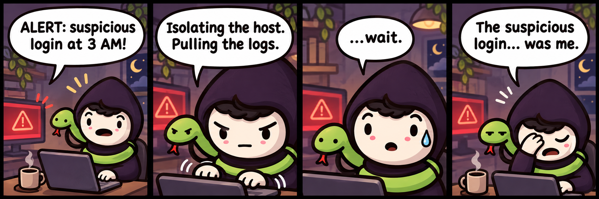

<h1>Fatih Serdar Çakmak</h1>

I build open-source tools for AI security, AI agents and İTÜ students.

## `~/featured`

<table>
<tr>
<td width="50%" valign="top">

### 🛡️ [Tamga](https://github.com/yatuk/tamga)
 `Go` `Python` `Next.js`

A self-hosted proxy that sits in front of your LLM provider. It redacts PII, blocks leaked secrets and catches prompt injection, with scanning under a millisecond. Includes KVKK, BDDK, GDPR and PCI-DSS mappings.
[tamgaproxy.com](https://tamgaproxy.com)

</td>
<td width="50%" valign="top">

### 🎼 [Multi-Model Orchestra](https://github.com/yatuk/multi-model-orchestra)
 `Python`

Routes coding work across Claude, GPT (Codex), Kimi and DeepSeek. Every model runs through one runner with hard status gates. Writes happen only in worktrees. It also has a blind council and a benchmark.

</td>
</tr>
<tr>
<td width="50%" valign="top">

### 🎓 [İTÜ MCP](https://github.com/yatuk/itu-mcp)
 `Python` `FastMCP`

Connects İTÜ's Ninova and OBS to Claude, Cursor and Codex. You can ask about course files, assignments, grades and your transcript in plain language.
[pypi](https://pypi.org/project/itu-mcp/)

</td>
<td width="50%" valign="top">

### 📡 [MCPRadar](https://github.com/yatuk/mcpradar)
 `Python`

Scans MCP servers before your agent runs them. It catches tool poisoning, prompt injection and supply-chain rug pulls, and outputs SARIF. See the [public leaderboard](https://yatuk.github.io/mcpradar).

</td>
</tr>
</table>

## `~/more`

| Project | What it does | Stack |
|---|---|---|
| ⚙️ **[SOC n8n Workflows](https://github.com/yatuk/soc-n8n-workflows)** | Ten import-ready n8n playbooks for alert triage, phishing analysis, IOC enrichment and CVE watch. | `n8n` |
| 🎯 **[SOC Simulation](https://github.com/yatuk/soc-simulation)** | A simulated SOC shift with 127 alerts, 126 false positives and 1 real threat. Includes MITRE ATT&amp;CK mapping. [Live demo](https://yatuk.github.io/soc-simulation/) | `Python` |
| 🗂️ **[İTÜ Archive](https://github.com/yatuk/itu-archive)** | OBS only shows the current term, so this keeps every course schedule since 2016: 27 terms and over 64k sections. [itu-ders.com](https://itu-ders.com) | `Go` |
| 🔋 **[BatteryHub + Claude](https://github.com/yatuk/Wireless-Device-Battery-Monitor)** | Shows wireless device batteries and your weekly Claude usage limit on the Windows taskbar. | `C++` `Electron` |
| 🟢 **[Kick Bulk Mod](https://github.com/yatuk/kick-bulk-mod)** | Bans, times out or unbans many Kick chat users at once from a simple web UI. | `TypeScript` |
| 🧪 **[php2shell session gap lab](https://github.com/yatuk/php2shell-session-gap-lab)** | A loopback-only lab for PHP session serialize-handler mismatches. Includes a harmless proof and a negative control. | `Python` `PHP` |

## `~/stack`

  

